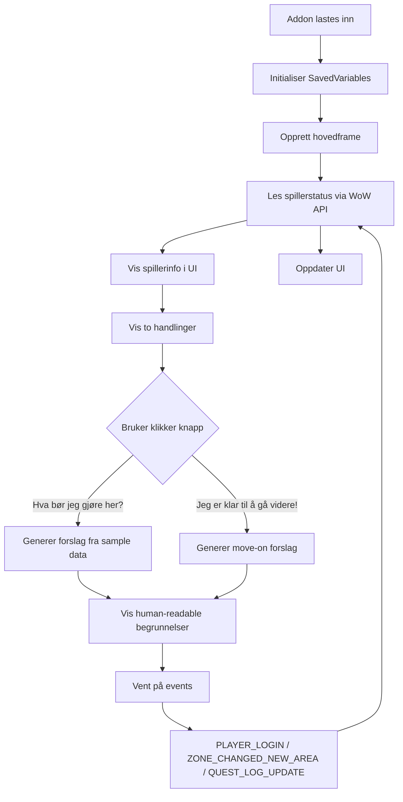

# Azeroth Companion

Dette prosjektet er en liten WoW Classic: Season of Discovery-addon for å gi nyttige, forklarbare anbefalinger om hva man bør gjøre. Målet er å være en hjelpeassistent for questing, ikke en auto-spiller eller XP/hour-optimering.

## Hva vi bygger

- Et lite, flyttbart addon-vindu
- Visning av spillerstatus i spillet
- To hovedmoduser:
  - “Hva bør jeg gjøre her?”
  - “Jeg er klar til å gå videre!”
- Forklarbare anbefalinger med tydelige grunner
- En struktur som lar prosjektet vokse gradvis uten å bli for komplisert

## Læringsmål

Dette er både et læringsprosjekt og et hobbyprosjekt. Målet er at vi skal lære Lua og WoW-addon-arkitektur på en måte som er praktisk og gjennomførbar, uten å starte med en altfor stor og risikabel implementasjon.

## Veikart og fremdriftsplan

Se roadmap-dokumentet her:

- [docs/ROADMAP.md](docs/ROADMAP.md)

## Nåværende status

- Fase 0 er fullført.
- Fase 1 er fullført og testet i WoW: addon-shell, UI, spillerstatus, eksempelknapper, resize og lokal deploy.
- Fase 2 er påbegynt: strukturerte fiktive quest-fixtures og en ren filtreringsmodul er lagt til.
- `/acdb <questID>` kan brukes til å inspisere QuestieDB lokalt hvis den valgfrie provider-addonen er installert. Dette er en read-only probe, ikke en dataintegrasjon i anbefalingene.
- I WoW er vinduet bekreftet synlig, åpne/lukke-, flytt- og resizebart; spillerstatus med fraksjon vises, resize-grensene fungerer, størrelsen beholdes etter `/reload`, `/ac` virker, og ingen feillogg ble observert.
- Vindusposisjon og -størrelse er bekreftet å overleve reload og relog.
- Tekstwrappingen er testet: spillerfelt flyttes samlet mellom linjer.
- Sonefeltet oppdateres etter hearthstone; vindusstørrelse/-posisjon overlever reload og relog.
- Fixture-forslag filtreres etter nivå, fraksjon, fixture-status og forutsetninger, og «gå videre» utelukker gjeldende sone.
- Questlogg og fullføringsstatus er ikke koblet til; fixture- og quest-item-dropverdier er demonstrasjonsdata, ikke spillfakta.
- QuestieDB er en separat, valgfri avhengighet og distribueres ikke med Azeroth Companion.
- Anbefalingsteksten har nå et scrollområde. Koordinater hentes med Classic `C_Map` og er ment vist over minimapets sonetekst.
- Neste steg er å teste fixture-filtrene, scrollingen, koordinatvisningen og `/acdb`-proben i WoW.

## Lokal deploy

Kjør dette fra prosjektmappen for å kopiere addonet til WoW Classic Era:

```sh
./scripts/deploy.sh
```

Skriptet leser først `.localenvs` i prosjektroten hvis filen finnes. Filen er ignorert av Git, så lokale deploy-innstillinger blir ikke med ved push. Den kan for eksempel inneholde:

```sh
WOW_ADDONS_DIR="/sti/til/World of Warcraft/_classic_era_/Interface/AddOns"
```

Hvis `.localenvs` mangler eller ikke angir `WOW_ADDONS_DIR`, prøver skriptet standard installasjonsmapper på macOS. Variabler i filen lastes som shell-konfigurasjon; legg bare inn egne, betrodde variabeldefinisjoner. Deploy kopierer `.toc`-filen, konstantene, quest-fixture, anbefalingsmodul og hovedfil. Det endrer ikke SavedVariables.

## Testing

Se testdokumentasjonen her:

- [docs/TESTING.md](docs/TESTING.md)

## Prosjektfaser

- [x] Fase 0: Oppsett og prosjektforståelse
- [x] Fase 1: MVP-addon shell
- [ ] Fase 2: Fiktive quest-data og anbefalinger
- [ ] Fase 3: Reise- og eventyrsammenheng
- [ ] Fase 4: Quest-repository og ekte data
- [ ] Fase 5: Trener- og bybesøkslogikk
- [ ] Fase 6: Testing, kvalitet og polish

## Flyt i addon-et



## Arbeidsflyt

1. Open this folder as your VS Code workspace.
2. Enable GitHub Copilot and agent mode; ensure agent skills are enabled in your Copilot version.
3. Ask: `Use the azeroth-addon-development skill. Read docs/PRODUCT.md, propose the architecture and the smallest MVP, and wait for my approval before generating addon code.`
4. Deploy addon-filene med `./scripts/deploy.sh`, og test dem i WoW Classic/SoD.

## Viktige retningslinjer

- Start med minste fungerende MVP.
- Verifiser Classic Era/SoD API før vi antar noe.
- Bruk eksempeldata først for å lære logikk og UI.
- Behold spillerens kontroll; vi anbefaler ikke automatiske handlinger.
- Bruk `/reload` og `/console scriptErrors 1` under testing.

